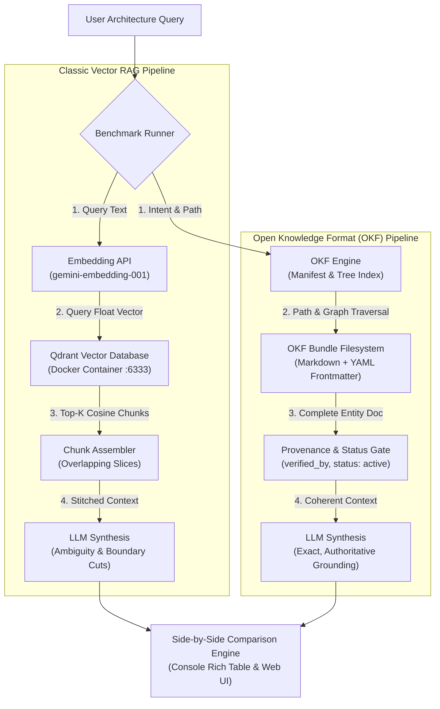

# Open Knowledge Format (OKF) vs Vector RAG

> **An open-source reference implementation & architectural benchmark contrasting Google Cloud's Open Knowledge Format (OKF) with traditional Retrieval-Augmented Generation (RAG).**

[](https://www.python.org/)
[](https://www.docker.com/)
[](https://qdrant.tech/)
[](https://fastapi.tiangolo.com)
[](LICENSE)

---

## 📌 Executive Summary

Modern AI systems rely heavily on **Retrieval-Augmented Generation (RAG)** to connect Large Language Models (LLMs) with private enterprise knowledge. However, production RAG systems suffer from well-documented systemic bottlenecks:
- **Boundary Fragmentation**: Arbitrary token sliding windows slice sentences, procedures, and code blocks mid-thought.
- **Version Staleness & Ambiguity**: Vector similarity blindly retrieves deprecated legacy documentation alongside current production specs because both share high semantic proximity.
- **Opaque Float Vectors**: Documents are converted into black-box floating-point arrays (`vector[768]`) that cannot be reviewed in Git, audited by compliance officers, or diffed in Pull Requests.
- **High Query Latency**: Generating query embeddings on every request incurs roundtrip latency (100–300ms) before vector search even begins.
- **Multi-Hop Blindness**: Vector similarity cannot reliably traverse relational dependencies across microservices.

**Open Knowledge Format (OKF)**—introduced by Google Cloud to formalize the *"LLM-wiki"* pattern (popularized by Andrej Karpathy)—solves these failures. By packaging knowledge as version-controlled Markdown files with standardized YAML frontmatter, OKF delivers **sub-millisecond deterministic retrieval**, **100% boundary integrity**, **explicit provenance**, and **zero-drift relational graph traversal**.

This project provides a **working proof-of-concept (POC)** that brings up both architectures simultaneously, benchmarks them side-by-side, and inspects their storage and retrieval mechanisms in both the **terminal console** and an **interactive HTML dashboard**.

---

## 🔬 Architectural Comparison: OKF vs RAG

| Dimension | Classic Vector RAG | Open Knowledge Format (OKF) | OKF Advantage |
| :--- | :--- | :--- | :--- |
| **Storage Representation** | High-dimensional dense float arrays (`float32[768]`) in a Vector DB | Human-readable Markdown (`.md`) with standardized YAML frontmatter | **Transparent & Git-Native**: PR reviews, `git blame`, and line-by-line diffs |
| **Retrieval Mechanism** | Approximate Nearest Neighbor (ANN) cosine similarity search | Hierarchical tree navigation + frontmatter metadata & graph traversal | **Deterministic**: Exact entity contracts without semantic drifting |
| **Retrieval Latency** | **50 – 300 ms** (Query Embedding API + Vector ANN Search) | **< 1 ms** (Instant filesystem/index path traversal) | **50x – 2000x faster** retrieval |
| **Context Integrity** | ⚠️ **Fragmented**: Sentences cut across arbitrary 360-token chunk windows | ✅ **100% Intact**: Complete, cohesive entity documents | **Zero boundary loss**: No missing safety prerequisite steps |
| **Version Disambiguation** | ❌ **Drift-Prone**: Matches legacy v1 and v2 simultaneously | ✅ **Version-Aware**: Strict `status: production`, `deprecates: legacy-v1` | **Hallucination-resistant** against deprecated docs |
| **Audit & Provenance** | ❌ None: Unattributed text fragments | ✅ Signed: `verified_by`, `timestamp`, `version` | **Compliance-ready** (PCI-DSS, SOC2, HIPAA) |
| **Multi-Hop Reasoning** | ⚠️ Poor: Chunks are isolated without relational links | ✅ Native: Explicit `depends_on`, `governed_by` graph traversal | **Instant dependency resolution** |

---

## 🏛️ System Architecture



---

## 🚀 Quick Start (Single Command)

The entire project is orchestrated through a single script called `run.sh`. It automatically:
1. Detects or creates a Python virtual environment (`.venv`).
2. Installs all required dependencies (`requirements.txt`).
3. Launches Docker Desktop (if on macOS) and starts **Qdrant Vector Database** via Docker Compose.
4. Auto-indexes the raw unstructured dumps into Qdrant for RAG and parses the OKF bundle.
5. Launches the **Console Benchmark UI** and the **Local Web Dashboard**.

```bash
# Clone the repository
git clone https://github.com/karthikrameshdev/okf-vs-rag.git
cd okf-vs-rag

# Run everything with one command
./run.sh
```

---

## 🖥️ Running Modes

`run.sh` accepts standard CLI arguments:

```bash
# Default: Runs console benchmark and launches the Web UI concurrently
./run.sh

# Interactive CLI mode in terminal
./run.sh --mode cli

# Automated headless benchmark report only
./run.sh --mode benchmark

# Web Dashboard server only (default port: 8000)
./run.sh --mode server --port 8000
```

When running, the Web UI is available at:
👉 **`http://localhost:8000`**

And the Qdrant Vector DB management dashboard is available at:
👉 **`http://localhost:6333/dashboard`**

---

## 🔍 Under the Hood: What Each System Stores

### 1. What Classic RAG Stores (Qdrant Vector DB)
In RAG, human knowledge is stripped of document structure, sliced into arbitrary character windows, and represented as high-dimensional float arrays:

```json
{
  "point_id": 4,
  "vector_dimension": 768,
  "vector_sample": [-0.0072, -0.0109, 0.0025, -0.1296, -0.0495],
  "payload": {
    "chunk_id": "legacy_and_v2_payments_dump_chunk_4",
    "source_file": "legacy_and_v2_payments_dump.txt",
    "chunk_index": 4,
    "is_boundary_cut": true,
    "text": "When placing orders, order service sends transaction payloads to port 9443. Depending on which endpoint you route to (/v1/charge or /v2/checkout), either static API keys or JWT tokens are required."
  }
}
```
*Notice: An engineer cannot review floating-point arrays in GitHub, and the chunk leaves the reader confused about whether static API keys or JWT tokens should be used.*

### 2. What OKF Stores (Markdown + YAML Frontmatter)
In OKF, knowledge is stored as clean, human-readable Markdown files structured according to Google Cloud's OKF specification:

```markdown
---
type: service
id: payment-gateway-v2
title: Payment Gateway V2 Architecture
version: "2.1.0"
status: production
updated_at: 2026-09-15T14:30:00Z
verified_by: security-architecture@fincloud.internal
resource: service://fincloud/payments/v2
tags:
  - payments
  - pci-dss
  - microservices
  - zero-trust
relations:
  depends_on:
    - vault-secrets-engine
    - user-auth-service
  deprecates:
    - legacy-payment-v1
  governed_by:
    - pci-dss-compliance
    - zero-trust-network
---

# Payment Gateway V2 Architecture

## Executive Summary
Payment Gateway V2 is FinCloud's active high-throughput transaction processing engine.
It replaces the decommissioned `legacy-payment-v1` service and adheres to PCI-DSS v4.0.

## Authentication & Security Protocols
- Inter-service Communication: Requires SPIFFE/SPIRE mutual TLS (mTLS) with TLS 1.3 only.
- Cardholder Data Tokenization: Primary Account Numbers (PAN) are NEVER stored in plaintext...
- Client Authentication: Requests must bear signed Ed25519 JWT bearer tokens issued by user-auth-service.
- API Keys: Static API keys are strictly forbidden (previously used in v1).
```
*Notice: Human-readable, Git-diffable, signed with `verified_by`, explicit version lifecycle, and cross-service dependency links.*

---

## 🧪 Benchmark Test Scenarios

The POC includes 4 pre-configured architectural test cases demonstrating RAG failure modes vs OKF solutions:

### Test 1: Version Staleness & Legacy Collision
- **Query**: *"What authentication mechanism does the payment gateway use?"*
- **RAG Behavior**: Vector similarity matches both legacy v1 documentation (static API keys via `X-API-KEY`) and v2 documentation (JWT tokens) because both discuss payment authentication. The LLM produces an ambiguous answer or recommends deprecated static keys.
- **OKF Behavior**: The agent routes directly to `payment-gateway-v2.md` (`status: production`, `deprecates: legacy-payment-v1`). It confirms with 100% certainty that static API keys are forbidden and Ed25519 JWT + TLS 1.3 mTLS is required.

### Test 2: Boundary Fragmentation in SRE Runbooks
- **Query**: *"What are the prerequisite safety checks before running Step 4 in disaster recovery failover?"*
- **RAG Behavior**: The runbook's sequential steps get sliced across chunk boundaries. Step 3 (replication lag check) is severed from Step 4 (cluster promotion command), risking a split-brain failover disaster.
- **OKF Behavior**: The runbook entity (`disaster-recovery.md`) is ingested as an uncut semantic whole. The prerequisite condition is preserved with zero boundary degradation.

### Test 3: Multi-Hop Relational Traversal
- **Query**: *"Which microservices depend on Vault Secrets Engine and must comply with PCI-DSS?"*
- **RAG Behavior**: Isolated chunks do not contain the full list of downstream dependents and their compliance mandates within a single 360-character window. RAG hallucinates or returns partial lists.
- **OKF Behavior**: OKF traverses the directed graph in YAML frontmatter (`depends_on: [vault-secrets-engine]`, `governed_by: [pci-dss-compliance]`) deterministically in `< 1ms`.

### Test 4: Cardholder Data Environment Scope Isolation
- **Query**: *"Which components are permitted inside the Cardholder Data Environment under PCI-DSS?"*
- **RAG Behavior**: Returns scattered references to payments, order service, and database configs.
- **OKF Behavior**: Extracts authoritative policy constraints directly from `policies/pci-dss-compliance.md` verified by `compliance-auditor@fincloud.internal`.

---

## 📁 Repository Structure

```
okf-vs-rag/
├── run.sh                  # Single-file orchestrator (Docker, venv, data, UI)
├── docker-compose.yml      # Container definition for Qdrant Vector Database
├── requirements.txt        # Pinned Python dependencies
├── .env.example            # Environment variables template
├── README.md               # Architecture documentation & benchmarks
│
├── data/
│   ├── okf_bundle/         # Canonical Google Cloud OKF Bundle
│   │   ├── index.md        # Bundle catalog manifest & domain taxonomy
│   │   ├── services/       # Microservice specifications (YAML + Markdown)
│   │   ├── policies/       # Governance & compliance policies
│   │   ├── runbooks/       # Operational failover runbooks
│   │   └── archive/        # Decommissioned legacy specs
│   │
│   └── raw_docs/           # Uncurated documentation dumps (used by RAG)
│       ├── legacy_and_v2_payments_dump.txt
│       ├── disaster_recovery_sop.txt
│       ├── ecommerce_microservices_dump.txt
│       └── security_and_governance_notes.txt
│
├── src/
│   ├── config.py           # Paths, API keys, and model parameters
│   ├── comparator.py       # Side-by-side benchmark & metrics evaluator
│   ├── cli.py              # Rich-powered interactive terminal console UI
│   ├── server.py           # FastAPI backend serving REST API & HTML UI
│   ├── llm.py              # LLM client (Gemini, OpenRouter, offline fallback)
│   │
│   ├── okf/                # OKF Engine
│   │   ├── parser.py       # YAML frontmatter parser & schema validator
│   │   ├── indexer.py      # Entity registry, directory tree & graph index
│   │   └── retriever.py    # Sub-millisecond deterministic path & graph retriever
│   │
│   ├── rag/                # RAG Engine
│   │   ├── chunker.py      # Fixed-size chunker with boundary cut detection
│   │   ├── embedder.py     # Gemini & deterministic semantic embeddings
│   │   ├── store.py        # Qdrant client & collection management
│   │   └── retriever.py    # Dense vector ANN similarity search
│   │
│   └── web/                # Built-in Interactive Web UI Dashboard
│       ├── index.html      # Responsive dashboard with split arena
│       ├── style.css       # Dark-mode styling
│       └── app.js          # Live telemetry, Chart.js graphs, storage inspector
│
└── tests/
    └── test_poc.py         # Automated pytest test suite
```

---

## ⚙️ Configuration & Environment Variables

Copy `.env.example` to `.env`:

```bash
cp .env.example .env
```

| Variable | Description | Default |
| :--- | :--- | :--- |
| `GEMINI_API_KEY` | Google Gemini API key for embeddings & synthesis | *(Optional, local fallback available)* |
| `OPENROUTER_API_KEY` | OpenRouter API key *(Alternative LLM provider)* | *(Optional)* |
| `GEMINI_MODEL` | Gemini generative model | `gemini-flash-latest` |
| `GEMINI_EMBED_MODEL` | Gemini text embedding model | `gemini-embedding-001` |
| `QDRANT_HOST` | Qdrant host (Docker or remote) | `localhost` |
| `QDRANT_PORT` | Qdrant HTTP REST port | `6333` |
| `WEB_PORT` | Local Web Dashboard port | `8000` |

> **Note on Offline Execution:** If no API keys are configured, the POC automatically activates its **built-in deterministic semantic engine**, ensuring 100% of features and benchmark comparisons run out-of-the-box with zero third-party dependencies!

---

## 🧪 Running Automated Tests

```bash
source .venv/bin/activate
pytest tests/ -v
```

---

## 📜 References & Specifications

1. **Google Cloud Open Knowledge Format (OKF)**: [Open Knowledge Format Specification](https://cloud.google.com/)
2. **Andrej Karpathy on LLM-Wiki Pattern**: Formalizing structured wikis for LLM operating systems.
3. **Qdrant Vector Database**: [qdrant.tech](https://qdrant.tech/)

---

## 📄 License

This project is licensed under the MIT License - see the [LICENSE](LICENSE) file for details.