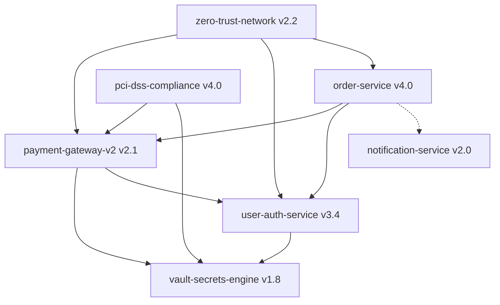

# FinCloud Architecture & Governance Knowledge Index

Welcome to the FinCloud Open Knowledge Format (OKF) repository. This bundle defines the official,
curated, single-source-of-truth knowledge graph for systems, security standards, and disaster recovery.

## Domain Taxonomy & Entities

| Domain | Entity ID | Title | Status | Governed By | Path |
| :--- | :--- | :--- | :--- | :--- | :--- |
| **Services** | `payment-gateway-v2` | Payment Gateway V2 Architecture | production | `pci-dss-compliance`, `zero-trust-network` | [payment-gateway-v2.md](file:///data/okf_bundle/services/payment-gateway-v2.md) |
| **Services** | `user-auth-service` | User Authentication & Identity Service | production | `zero-trust-network` | [user-auth-service.md](file:///data/okf_bundle/services/user-auth-service.md) |
| **Services** | `vault-secrets-engine` | Enterprise HashiCorp Vault Engine | production | `pci-dss-compliance` | [vault-secrets-engine.md](file:///data/okf_bundle/services/vault-secrets-engine.md) |
| **Services** | `order-service` | Order Management & Saga Orchestrator | production | `zero-trust-network` | [order-service.md](file:///data/okf_bundle/services/order-service.md) |
| **Services** | `notification-service` | Multi-channel Event Notification Service | production | `zero-trust-network` | [notification-service.md](file:///data/okf_bundle/services/notification-service.md) |
| **Policies** | `pci-dss-compliance` | PCI-DSS v4.0 Cardholder Security Policy | mandatory | - | [pci-dss-compliance.md](file:///data/okf_bundle/policies/pci-dss-compliance.md) |
| **Policies** | `zero-trust-network` | Enterprise Zero-Trust mTLS Standard | mandatory | - | [zero-trust-network.md](file:///data/okf_bundle/policies/zero-trust-network.md) |
| **Runbooks** | `disaster-recovery` | Production Multi-Region Failover Runbook | active | - | [disaster-recovery.md](file:///data/okf_bundle/runbooks/disaster-recovery.md) |
| **Archive** | `legacy-payment-v1` | Legacy Payment Service (Decommissioned) | deprecated | - | [legacy-payment-v1.md](file:///data/okf_bundle/archive/legacy-payment-v1.md) |

## Dependency & Governance Graph

## How AI Agents Query this OKF Bundle
1. **Explicit Routing**: Agents parse queries targeting known entity IDs (`payment-gateway-v2`) or domains (`services/`).
2. **Metadata Traversal**: Frontmatter `relations` fields allow multi-hop reasoning (e.g. all services governed by `pci-dss-compliance`).
3. **Audit Trail**: Every document is signed with `verified_by` and semantic versioning to prevent hallucination from stale documents.
